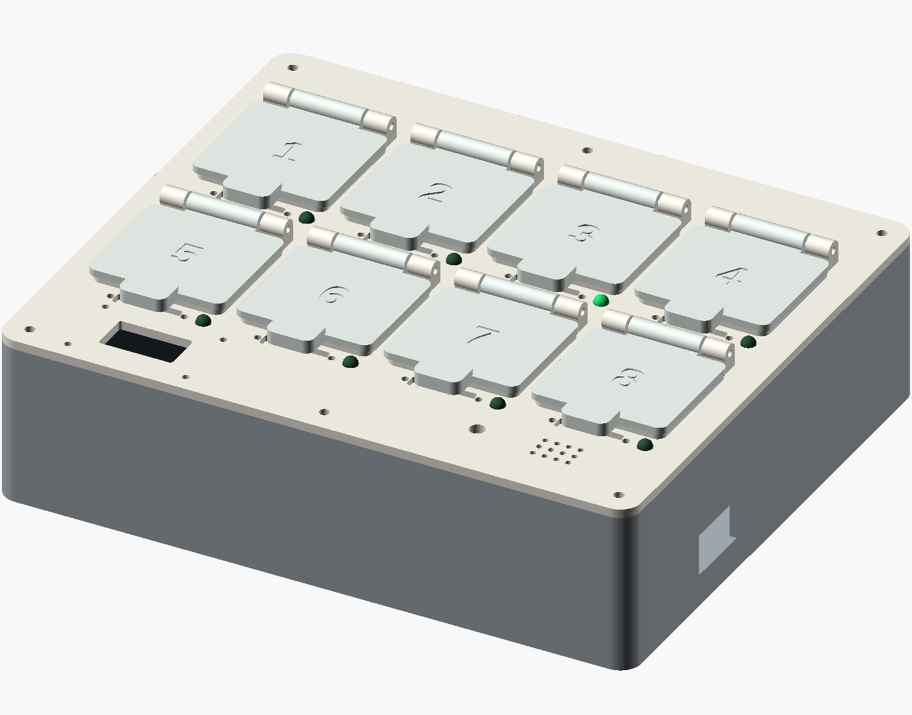
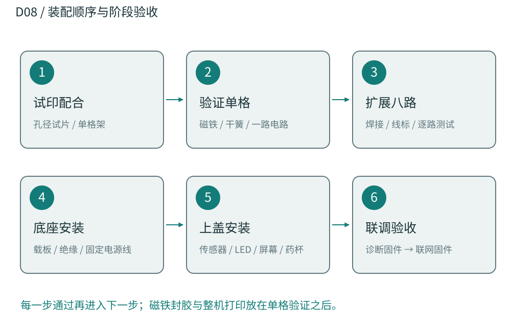
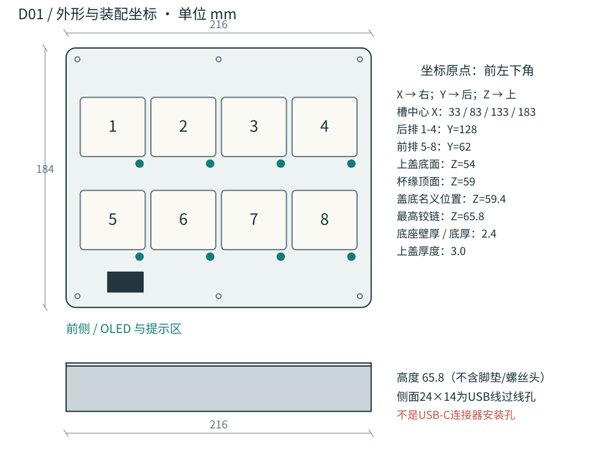
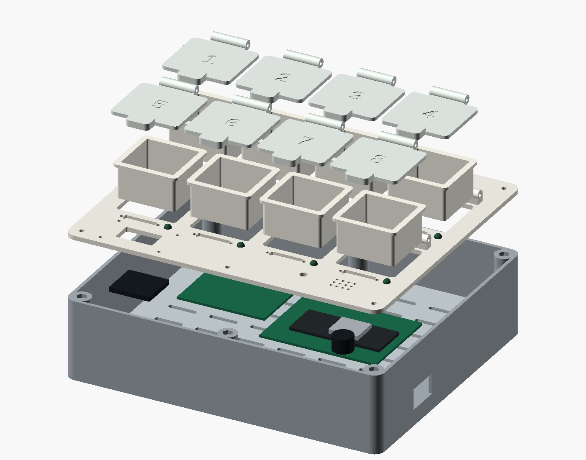
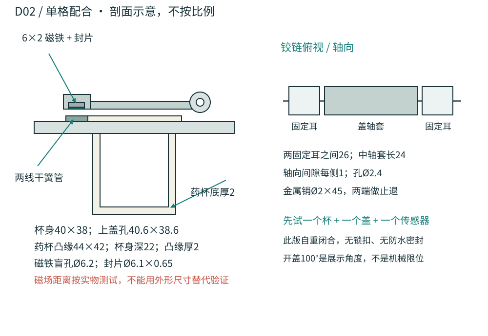
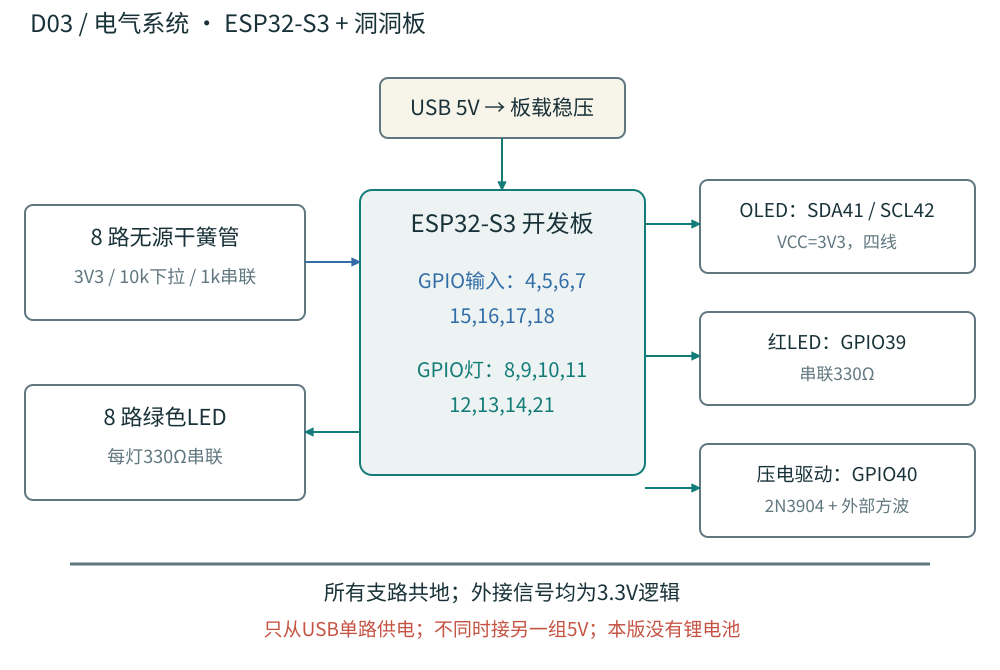
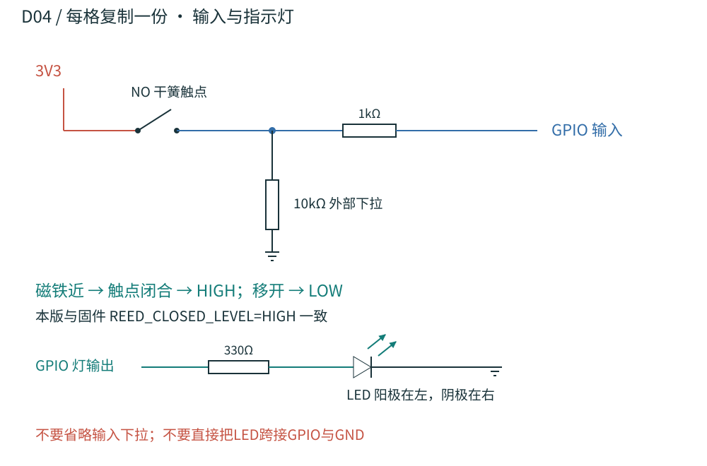
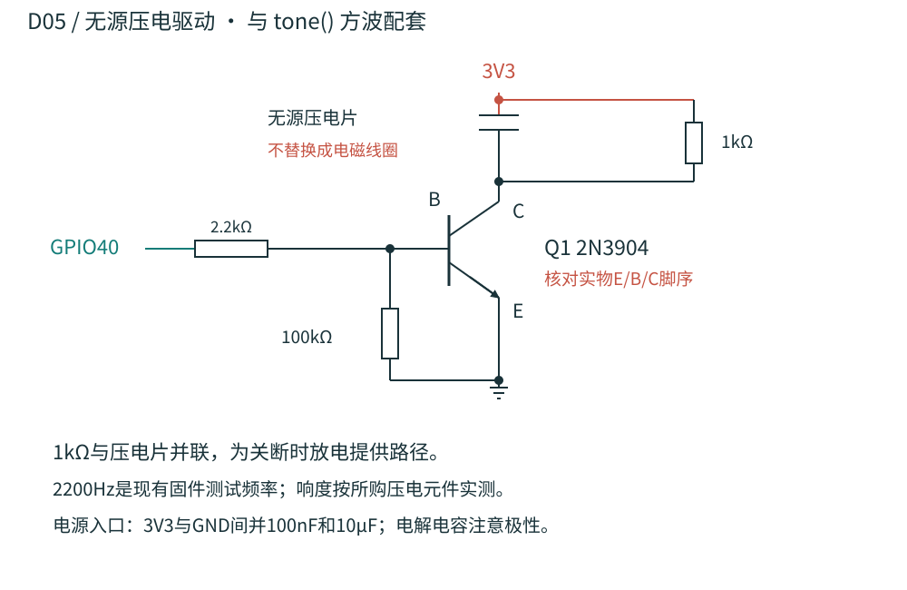
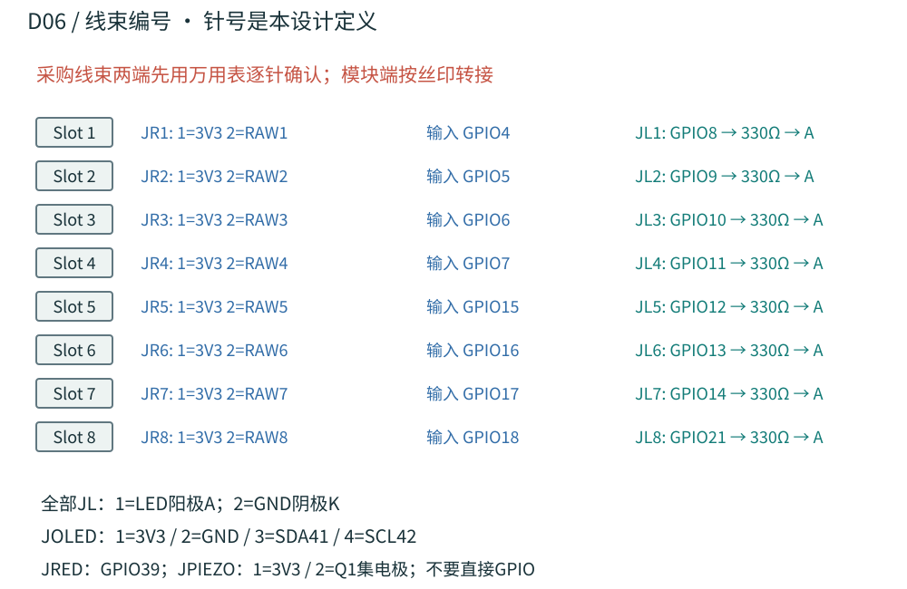
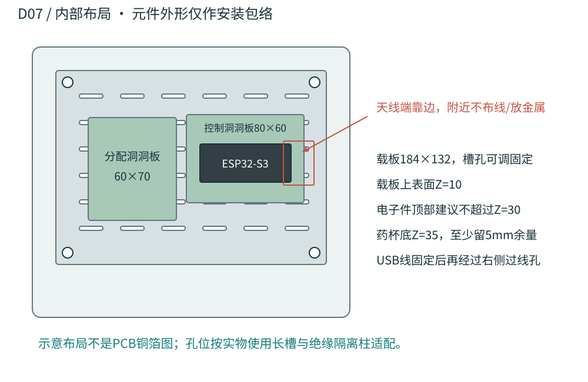

# Smart Pillbox R1 组装指南

## 从桌面毛坯到可组装原型
这是一套从零采购与制作的工程初版。它把八格翻盖、开盖检测、灯光指引、声音提醒和网页事件回传整合到同一机壳中。

| 规格 | 本版设计 |
| --- | --- |
| 外形 | 216 × 184 × 65.8mm，不含脚垫和螺丝头 |
| 结构 | 8个独立药杯；销轴翻盖；上盖可拆；USB供电 |
| 输出 | 17种STL + OpenSCAD源文件 + 8张设计图 + 固件 + BOM |
| 状态 | 网格与数字几何已检查；尺寸配合、电气和磁场待实测 |
先做单格样件，再打印整机。后续以本包CAD为制作依据；早期AI渲染图仅用于外观方向。

## 01 / 制作路线与文件入口

目录入口：index.html；中文手册：guide/；打印零件：stl/；可修改模型：cad/pillbox.scad；矢量图：drawings/；接线及采购表：electronics/；测试和联网程序：firmware/。
本版采用开发板 + 洞洞板。电气图是可照着焊接的连接设计，载板图是位置规划；未输出定制PCB/Gerber。待实际模块和连接器确定后，才能冻结PCB封装。
本版提供STL和可编辑SCAD源文件；未提供STEP或机器专用G-code。STL需进入实际打印机的切片器，检查方向、支撑、桥接和打印范围。
元件采购以尺寸包络和电气规格为准。标为“采购确认”的项目先拿到数据表或实物，再批量购入。

## 02 / 采购清单：电子部分
| 编号/名称 | 数量 | 规格与确认点 |
| --- | --- | --- |
| E01 ESP32-S3 开发板 | 1 + 1备用 | 完整引出 GPIO4-18/21/39/40/41/42；带稳压与 USB；核对实际版本 |
| E02 封装常开干簧开关 | 8 + 2备用 | 两线无源 NO；本体不大于20×4.5×3.5mm；不带比较器大板 |
| E03 圆片磁铁 | 8 + 2备用 | 直径6mm、厚2mm；先与干簧管配对试验 |
| E04 绿色 LED | 8 + 2备用 | 5mm普通指示灯；非大功率；额定电流不少于5mA |
| E05 红色 LED | 1 + 1备用 | 5mm普通指示灯 |
| E06 SSD1306 OLED | 1 | I2C 128×64、四线、3.3V；采购目标PCB≤34×26mm；显示有效区匹配25×14窗口 |
| E07 无源压电蜂鸣器 | 1 + 1备用 | 外部方波驱动，允许3.3V激励，直径≤15mm；不买电磁线圈型替代 |
| E08 2N3904 NPN | 1 + 1备用 | TO-92；按所购厂商数据表确认 E/B/C，不能按照片猜脚序 |
| E09 330Ω电阻 | 9 + 3备用 | 每个LED各1只，1/4W |
| E10 10kΩ电阻 | 8 + 2备用 | 每路干簧输入各1只外部下拉，1/4W |
| E11 1kΩ电阻 | 9 + 3备用 | 8只输入串联；1只并联压电片用于放电，1/4W |
| E12 2.2kΩ / 100kΩ电阻 | 各1 + 2备用 | NPN基极串联 / 基极-发射极下拉 |
| E13 去耦电容 | 100nF×2；10μF×1 | 至少6.3V；10μF若有极性，正端接3V3；置于支路供电入口 |
以上为采购规格，未绑定具体商家SKU。全部接口按3.3V逻辑设计；两线无源干簧管与原项目三线模块的接法不同，见D04。

## 03 / 采购清单：装配与材料
| 编号/名称 | 数量 | 规格与确认点 |
| --- | --- | --- |
| E14 洞洞板 | 2 | 控制板约80×60mm；分配板约60×70mm；2.54mm焊盘 |
| E15 2.54mm配对线束 | 2针×18套；4针×1套 | 带防反插外壳；预压接；同系列插头插座；按本包针号逐线通断核对 |
| E16 电线与绝缘材料 | 1套 | 26-28AWG软线、热缩管、线标、扎带、绝缘垫、护线套 |
| E17 USB电源及数据线 | 1套 | 5V/2A适配器；线与实际开发板USB口匹配；通过侧面过线孔接开发板 |
| M01 铰链销 | 8 + 2备用 | 直径2.0mm，长45mm金属杆，去毛刺；两端留可拆止退措施 |
| M02 M3螺丝和螺母 | M3×8mm 6套；M3×16mm 4套 | 6套固定上盖；4套固定内部载板；另备垫片 |
| M03 M2螺丝和螺母 | M2×16mm 4套 | 固定OLED压板；根据实际屏幕堆叠改长度或垫片 |
| M04 非金属板卡隔离柱 | 1套 | M2/M3通用，约6mm高；载板上方电子总高度≤20mm |
| M05 脚垫 / 磁铁封口胶 | 4只 / 少量 | 脚垫≥3mm；兼容打印材料的胶；封口圆片必须牢固 |
| M06 绝缘泡棉 / 薄胶带 | 少量 | OLED压板缓冲；干簧管槽固定与封护；避免压碎传感器 |
| P01 打印耗材 | 按切片器计重 | PLA用于尺寸样件；PETG用于后续外壳；药杯仅放演示物 |
工具：温控电烙铁、万用表、剥线钳、游标卡尺、内六角/十字螺丝刀、去毛刺工具、小型手钻或铰刀。预压接线束可以减少装配错误。

## 04 / 外形、坐标与接口尺寸

上盖使用6枚M3×8螺丝，螺母放入底座顶部六角槽。内部电子载板由底座4个支柱支撑。维修从上方拆开，不需要破坏胶粘外壳。
右侧24×14mm开口让整条USB线进入机内，接开发板自身接口。它没有假定某个USB-C插座外形；正式面板接口需根据所购延长线重新建孔。

## 05 / 分解结构与零件关系

从上到下：8个编号盒盖 → 8个独立药杯 → 带传感器槽与固定轴耳的上盖 → 洞洞板/ESP32与通用载板 → 一体底座。销、磁铁、LED和螺丝是另购件。
杯的凸缘挂在上盖孔边；杯底在Z35。载板上表面在Z10，电子总高度限20mm时，杯底下仍有5mm名义净空。线束也不能超过这一包络。
模型中的电子板只表示占位尺寸，不代表可下单的PCB。OLED背板与垫柱在独立STL中，实际垫高按屏幕厚度调整。

## 06 / 单格机构与传感器标定

先试磁场，再封磁铁。干簧管触发受磁铁强度、距离和方向影响；槽位提供初始安装位置，不保证所有磁铁/传感器组合都会触发。
关盖观察稳定HIGH，开盖观察稳定LOW。若失败，先调整方向和垫高；必要时修改局部参数重印。确认相邻磁铁不会把另一格保持在闭合状态。
盖和杯不做气密密封，此版按桌面演示设计。磁铁封片及销端必须固定；运输扣具和防潮结构属于下一版。

## 07 / 电气总览与供电

开发板USB输入5V，经板载稳压产生3V3。外接OLED、传感器和压电支路均使用3V3；所有GND相连。不要把5V接到GPIO，也不要同时从USB和外部5V脚供电。
9只LED按每路最大约4.5mA估算，合计约41mA；8路10k下拉在全闭合时约2.6mA；压电放电电阻导通时约3.3mA，另加OLED和开发板自身消耗。实际稳压器余量与温升需按所购板检查。
GPIO40用于蜂鸣器，避开新版官方DevKitC-1板载RGB使用的GPIO38。完整引脚依据本包D06，不能把旧接线表中的38直接沿用。

## 08 / 每格电路：开盖输入与LED

JR两针接无源常开干簧触点。节点RAW通过10k下拉到GND，再经1k接ESP32输入。输入不依靠内部上拉：关盖触点导通时读取HIGH。
该输入电路复制8份。每只LED单独串330Ω，长脚/封装标识确认阳极；剪脚后不要只靠脚长判断。公共红灯同样串330Ω。
如果采购三针有源模块，需要另外验证3.3V供电、DO输出逻辑和体积；不能直接套用两针线束。优先按本包采购两线封装干簧管。

## 09 / 声音驱动与电源去耦

Q1基极经2.2k接GPIO40，发射极接GND，集电极接压电片负端；压电片正端接3V3。100k从基极接到发射极。压电片两端并联1k，帮助每个方波周期放电。
此图只适用于无源压电元件。若换成电磁蜂鸣器或有源模块，需要按该器件的数据表重新确定驱动、续流与固件信号，不能直接代换。
根据采购元件共振频率，可调整BUZZER_TONE_HZ。初版沿用2200Hz，响度是否够用须在实物上测试。

## 10 / 线束编号与焊接检查

JR1-JR8为传感器接口；JL1-JL8为绿色灯接口。JOLED的针号是本设计定义，市售屏幕排列可能不同，模块端必须按VCC/GND/SDA/SCL丝印转接。
焊接建议先完成3V3/GND母线，再做每路电阻和连接器。每完成一路就测通断并贴编号。洞洞板不是面包板，孔与孔通常不自动相连。
完整逐线连接表见electronics/wiring.csv。不要按导线颜色猜针号；上盖和底座之间留维修长度，用扎带做拉力固定。

## 11 / 内部布局与干涉控制

开发板安装在控制洞洞板或绝缘支架上；通用载板长槽用于调整孔位。不要为了配合渲染图而强行在开发板上钻孔。所有固定件都应避开焊点。
天线端朝机壳外侧，周围保持空旷，按具体模组指南落实天线净空。USB线不要绕过天线；屏幕和蜂鸣器固定在前侧提示区下方。
OLED背板由4枚M2螺丝拉紧，泡棉只负责温和定位。垫柱长度必须让玻璃不受压、显示区贴近窗口；随包6mm垫柱只是试装起点。

## 12 / 打印清单与切片起点
| STL文件前缀 | 数量 | 用途 |
| --- | --- | --- |
| 01-base | 1 | 底座 |
| 02-deck | 1 | 上盖与固定轴耳 |
| 03-cup | 8 | 演示药杯 |
| 04-lid-1 … 8 | 各1 | 编号盒盖 |
| 05-magnet-cap | 8 | 磁铁封片 |
| 06-electronics-carrier | 1 | 通用电子载板 |
| 07-oled-backplate | 1 | 屏幕背板 |
| 08-oled-spacer | 4 | 屏幕试装垫柱 |
| 09-fit-coupon | 1 | 孔径试片 |
| 10-single-cell-fixture | 1 | 单格验证支架 |
默认最大零件216×184mm。建议使用256×256mm或更大打印平台，留出裙边/边缘余量；未知打印机不能直接生成G-code。
起始切片参数：0.4mm喷嘴、0.20mm层高、4道墙、顶底至少5层、20%-30%填充。它们是试印起点，温度与速度按实际耗材配置。
底座开口朝上、药杯开口朝上、载板和背板平放。上盖底面朝下；铰链孔和轴耳下缘检查局部支撑。侧面过线孔的24mm桥接跨度检查桥接，必要时加局部支撑。
STL单位按mm导入，倍率100%。此页数量是单台整机加单格试验；试验件合格后可复用杯、盖与封片。

## 13 / 打印方向与尺寸核对
盒盖平坦底面朝下、字面朝上。磁铁盲孔朝平台侧，检查盲孔顶部桥接和可清理支撑。轴套底部可加小范围支撑，保持孔内清洁。
单格架支脚朝下，台面下方需要支撑。封片厚0.65mm，建议0.15mm层高，切片预览确认连续层，不强行按0.20mm层高四舍五入。
杯身与上盖孔单边名义间隙0.30mm；盖与杯缘名义高度间隙0.40mm；铰链孔2.40mm配2.00mm销。以上均需实物试印确认。
打印件仅用于桌面演示，药杯装惰性演示物。实际储药应采用材料与清洁性合适的成品内胆，并据其尺寸重新适配。
| 检查项 | 目标 | 确认方法 |
| --- | --- | --- |
| 机壳 | 216×184×65.8mm | 不含脚垫/螺丝头 |
| 药杯外形 | 44×42×24mm | 含凸缘；主体40×38mm |
| 药杯内腔 | 36×34×22mm | 圆角导致有效容积略小 |
| OLED板 | ≤34×26mm | 窗口25×14mm，焊脚留线 |
| 干簧管 | ≤20×4.5×3.5mm | 槽22×5×2mm，可略高于槽 |
| 电子件高度 | ≤20mm | 从载板上表面起算 |
| 磁铁 | Ø6×2mm | 盲孔Ø6.2mm，封片Ø6.1×0.65mm |
修改模型优先改fit_gap、pin_d、magnet_d、magnet_t、OLED_window等局部参数。整体长宽、排距和杯尺寸存在关联；调整后必须重出模型并检查干涉，不能只拉伸外壳。

## 14 / 实际组装：先完成单格
01 先打印最小验证集
先打印09-fit-coupon、10-single-cell-fixture、03-cup、04-lid-1、05-magnet-cap。单格架必须加支撑；磁铁封片建议0.15mm层高。用2mm销检查2.1/2.2/2.3/2.4mm孔，记录最顺畅的孔径。再用M3螺母测试6.5/6.7/6.9mm六角槽，选择可放入且不易转动的槽；默认nut_hex_d=6.7。不要缩放STL补偿配合。
02 试装药杯与铰链
药杯从上面放入单格架，凸缘承重。把盒盖中间轴套放到两只固定轴耳之间，穿入2×45mm销。孔有毛边时用手工铰孔处理，销端与固定轴耳端面用少量可剥离胶固定，禁止渗入转动轴套；维修先剥胶再抽销。此版采用自重闭合，无锁扣，适合桌面演示；不要强掰到铰链极限。
03 标定磁铁与干簧管
先不封胶。将磁铁放入盖下盲孔，两线干簧管放到对应槽位，沿槽改变方向和位置。关盖必须稳定HIGH，开盖必须稳定LOW；每次保持超过300ms。重复50次并检查相邻格不误触发，合格后才用圆片和胶封住磁铁。若检测距离不足，调整传感器/磁铁位置并重打局部样件。
04 焊接单路并验收
断电完成一个输入通道、一个LED和压电驱动电路。万用表确认电源和地无短路、LED极性正确、NPN脚序正确；上电测3V3。烧录hardware_bringup，串口115200，按1启动Slot1提醒，开盖应只记录一次并停止提醒。
在上述四步通过前，不批量封胶，不直接打印整机，也不把磁铁固定到不可拆的位置。

## 15 / 实际组装：扩展与合壳
05 打印并扩展八格
单格通过后，再打印底座、上盖、电子载板、OLED背板与余下药杯/盒盖。每次增加一路并验证。线束两端均贴相同槽号；电路板上安装外部下拉和串联电阻，所有地相连。
06 安装机内电子件
M3×16从底部穿过4个支柱，固定载板并加螺母。板卡用绝缘隔离柱或扎带固定，不能让焊点碰载板螺丝；载板上方总高度≤20mm。天线端靠外壁，附近留空。USB线经过侧面24×14过线孔，装护线并做拉力固定。
07 安装上盖组件
LED从下方装入上盖孔并固定；干簧管放入顶面槽，线从两侧小孔进入机内。OLED对准25×14窗口，用背板、绝缘泡棉、垫片和4枚M2螺丝轻压固定，避免压玻璃。蜂鸣器固定在出声孔下方。上盖线束留约80mm维修余量。
08 合盖并联调
向底座6个六角槽放M3螺母，再以6枚M3×8固定上盖，螺丝不必过紧。装药杯、磁铁封片、销和盒盖。先执行八格诊断，再使用单独生成的integrated_prototype固件接入已配对设备账户。逐格确认网页编号、指示灯和传感器一致。

## 16 / 固件、网页与测试流程
先打开firmware/hardware_bringup/hardware_bringup.ino。选择实际ESP32-S3板型，烧录后串口115200。按1-8启动对应格提醒，按0停止，按s打印所有盖状态。诊断程序无需Wi-Fi。
打开目标格：串口只出现一次OPEN、目标灯熄灭、提示音停止。打开其他格：红灯亮、提示音加快，原目标格仍保持提醒。持续开盖不应重复上报；关闭再打开应出现新事件。
OLED缺失不会阻止串口测试。OLED需要SSD1306，地址0x3C；如果实物地址不同，修改初始化位置。所有输入有300ms防抖，过快掀合可能被过滤。
联网页面测试用firmware/integrated_prototype/。将config.example.h复制成config.h，填写Wi-Fi、服务器地址和已注册/已配对设备ID。占位ID不会自动创建云端设备。
联网固件从现有项目生成独立副本，仅启用全部八格并把蜂鸣器改为GPIO40。原项目固件未被改写。库：ArduinoJson 7.x、Adafruit GFX、Adafruit SSD1306；ESP32 core提供WiFi/HTTPClient/Wire。
网页也要允许配置和触发Slot1-8。当前项目包含两格演示账户/路径，八路诊断通过不代表所有网页入口都已支持八格。使用现有已配对账户先验证两格，再确认八格计划和演示入口。
网络失败重试使用RAM队列，容量12，上传最多尝试3次；断电会丢失队列。该行为必须在现场演示前理解和测试。开盖事件不代表已吞服。

## 17 / 验收记录与故障定位
| 项目 | 操作 | 通过条件 |
| --- | --- | --- |
| T01 | 空载通电 | 3V3稳定；无异常发热；USB与外部5V不并接 |
| T02 | 单格开合50次 | 无漏报、无重复；闭合HIGH，打开LOW |
| T03 | 相邻干扰 | 只操作某格，其余7路状态保持正确 |
| T04 | 八格映射 | 编号、LED、串口和网页Slot一致 |
| T05 | 正确/错误格 | 正确格停提醒；错误格告警且目标格仍提醒 |
| T06 | 搬动与线缆 | 轻搬、开合、插拔后无松线；磁铁和销不脱落 |
| T07 | 连续运行 | 建议4小时；记录重启、掉线和温升 |
| T08 | 断网与重启 | 记录上传失败和恢复表现；不把RAM重试当断电保存 |
| T09 | 结构配合 | 杯可取出、线不夹压、上盖可维修、玻璃不受压 |
关闭却读LOW：检查干簧朝向、磁铁距离、3V3以及10k下拉接法。
始终HIGH：检查RAW短接3V3、磁铁过强或相邻格干扰。
灯亮错格：检查线束标签和D06的GPIO映射。
蜂鸣器无声：核对GPIO40、Q1脚序、压电器件类型和固件tone频率。
屏幕黑屏：检查3V3、I2C地址、SDA41/SCL42及模块端丝印。
能检测开盖但网页无记录：检查设备ID、API鉴权、服务器地址和网络；先看串口上传响应。

## 18 / 数字验证、实物边界与后续
已导出并检查17种STL：封闭网格、边方向一致、单一连通实体、正体积，最大XY尺寸216×184mm。详细结果在validation/mesh-report.json。
数字装配检查：41组实体交集测试通过，包含关盖状态及8个盖分别在0/30/60/90/100度的采样位置。实物的翘曲、收缩、铰链摩擦、磁力和导线弯曲不由该检查证明。
本包所有五张CAD视图直接由同一SCAD源文件渲染；SVG尺寸图按同一组名义尺寸制作。电子元件是包络占位，实物安装孔和PCB布线仍需采购后核对。
固件编译通过：bringup-compile.log；ESP32 Arduino core 3.3.11。尚未在实体设备烧录验证。
固件编译通过：integrated-compile.log；ESP32 Arduino core 3.3.11。尚未在实体设备烧录验证。
必须实测的四项：打印配合、磁场阈值、供电与温升、八格网页联动。通过后，再考虑专用PCB、USB面板接口、锁扣、防潮内胆和电池系统。
本次没有生成G-code、PCB Gerber或量产工艺图；当前文件覆盖的是一台可逐步试制的USB供电桌面功能原型。
重新生成：python3 scripts/export_models.py；python3 scripts/validate_meshes.py；使用装有reportlab的Python运行scripts/build_guide.py。OpenSCAD路径可用环境变量OPENSCAD指定。

## 19 / 参考资料与交接
Espressif 开发板说明（GPIO38板载RGB、GPIO限制）
https://documentation.espressif.com/esp-dev-kits/en/latest/esp32s3/esp32-s3-devkitc-1/user_guide_v1.1.html
Espressif 硬件设计指南（天线布置参考）
https://www.espressif.com/sites/default/files/documentation/esp32-s3_hardware_design_guidelines_en.pdf
SparkFun 干簧管原理（磁铁方向与距离影响触发）
https://learn.sparkfun.com/tutorials/reed-switch-hookup-guide/reed-switch-overview
onsemi 2N3904 数据表（按实物厂商封装核对脚序）
https://www.onsemi.com/download/data-sheet/pdf/2n3904-d.pdf
Prusa 打印设计（公差、支撑与桥接）
https://help.prusa3d.com/article/modeling-with-3d-printing-in-mind_164135
Prusa FDM接触材料与清洁性
https://help.prusa3d.com/article/food-safe-fdm-printing_112313
OpenSCAD 命令行导出
https://files.openscad.org/documentation/manual/Using_OpenSCAD_in_a_command_line_environment.html
项目依据：hardware/esp32-s3/smart_pillbox_demo/smart_pillbox_demo.ino 的当前引脚、状态逻辑与上传协议。派生记录见validation/firmware-origin.json。
交给打印店：stl/、本手册第12-13节、单格试装要求。交给电子同学：D03-D07、electronics/wiring.csv、BOM.csv和诊断固件。保留cad/源文件用于迭代。
